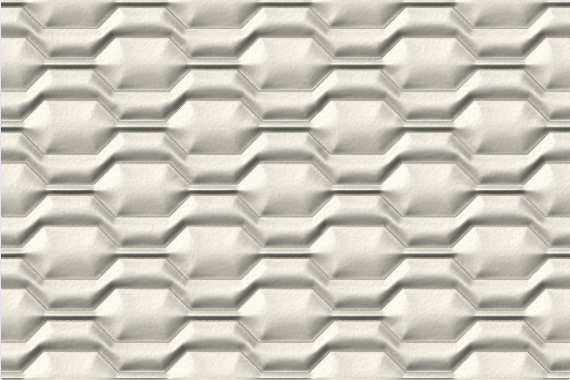

# AI CMF Pattern Studio

汽車內裝 CMF 團隊使用的本機參數化紋理工作台。React 19 + TypeScript + Vite，無後端、無登入、無付費 API。

## GitHub Pages 自動部署

正式網站：https://yunyun130523-create.github.io/cmf-pattern-studio/

已透過免費 GitHub Pages 部署。.github/workflows/pages.yml 會在 main 更新後自動檢查、建置、執行桌面／手機尺寸瀏覽器驗收，通過後發布。384 項測試與 66 項跨瀏覽器驗收已通過，完整紀錄見 DEPLOYMENT.md。

## 直接使用

用最新版 Chrome 或 Edge 開啟交付檔 `AI-CMF-Pattern-Studio.html`。網站的 JavaScript、樣式、圖示與 DWG 背景處理器都已內嵌，不需安裝 Node.js，也不需連網。

ZIP 中另有 `AI-CMF-Pattern-Studio.html`，可解壓後開啟。請勿在文字編輯器內預覽 HTML；請使用瀏覽器。

## 圖案設計改為 A→B · 2.0.0-alpha.34（已發布）

圖案設計的 A、B 分別是起始、結束形狀，中間改為漸變箭頭，移除相加按鈕。選擇 B 會啟用形狀漸變，比例與旋轉分別套用於兩端。電腦車縫的 A+B 合併功能保留。

「無漸變」選項仍可設定固定尺寸，再獨立啟用形狀變形；圖片點陣與一般圖案都支援。自訂形狀方向的綠色控制點也可在固定尺寸下操作。舊相加專案進入圖案設計時會轉為 A→B，保留兩端形狀與比例；無法插值的輪廓會保留資料並顯示既有提示。

## 預覽穩定性與圖片形狀漸變 · 2.0.0-alpha.33（已發布）

修正預覽影像在 React 提交前過早釋放的時序風險，換圖完成後才釋放舊影像，並釋放未顯示及卸載後的影像。預覽重用暫存畫布，繪製完成後才替換畫面；失效的 GPU 影像改用向量資料重畫，失敗時保留上一版。React 渲染例外會顯示專案備份及恢復按鈕，避免只剩白頁。

圖片的水平／垂直 A→B 形狀漸變改以實際可見點陣範圍計算，中央小圖也能完整到達兩端形狀；自訂方向仍使用畫布控制點。尺寸、明暗與形狀場保持獨立，SVG／PNG／JSON 使用相同幾何。

這些修正處理可重現的繪圖失敗與資源時序風險，尚不能確認涵蓋使用者所有白頁或瀏覽器分頁崩潰情況。

## 圖片點陣漸變按鈕修正 · 2.0.0-alpha.32（已發布）

修正圖片轉點陣後，漸變按鈕只變更選取狀態、預覽未變化的問題。圖片模式點選中心擴散、水平、垂直、不規則或無漸變時，會同步啟用圖片的漸變排列，立即更新預覽及匯出。切回規則模式會清除圖片殘留的隨機位置、旋轉與尺寸擾動，保留來源圖片、裁切、尺寸與間距。

## 漸變與圖片入口並列 · 2.0.0-alpha.31（已發布）

五種漸變模式與「圖片轉點陣」放在同一個兩欄區域，圖片上傳後立即銜接 A／B 幾何形狀。移除「圖片亮度」、「圖片對比」與「Gamma」三個滑桿，保留圖片上傳、裁切、尺寸、間距、密度、排列及匯出。舊 JSON 的明暗參數仍可還原，既有專案不改寫。

## 圖案設計操作順序 · 2.0.0-alpha.29（已發布）

將圖片上傳入口獨立為「圖案來源」，上傳區後立即銜接幾何形狀 A／B 及比例旋轉，再依序調整排列、點陣尺寸與明暗、圖片預覽與裁切、色彩，最後調整漸變。未使用圖片時則依序選形狀、設定網格尺寸，再設定漸變。

收合圖片設定仍保留一組可操作的幾何形狀，重新展開沿用目前形狀，不重複顯示 A／B 控制。不變更繪圖、尺寸、JSON 或匯出資料格式。

## 圖片上傳整合至圖案設計 · 2.0.0-alpha.28（已發布）

在「圖案設計 → 漸變模式」新增「圖片轉點陣」上傳按鍵；第一次點擊直接選擇 JPG／PNG／DWG。移除上方獨立圖片分頁，保留四個主分頁並列。

圖片設定在同頁展開，可收合而不移除來源或預覽；再次點擊可編輯或更換圖片。保留裁切、明暗、尺寸、間距、形狀、顏色與匯出功能，舊 JSON 圖片專案載入後會自動展開設定。

## 隨機點陣可恢復規則排列 · 2.0.0-alpha.27（已發布）

修正圖片點陣切到隨機排列後，位置隨機程度仍殘留 100% 的問題。切回規則矩陣、錯位、六角或漸變排列時，位置、旋轉及尺寸的隨機參數都會歸零。圖片、裁切、明暗、尺寸與間距保留原設定。

若已儲存的專案目前選了規則排列但仍有隨機參數，可直接按「恢復規則排列」；也可切換任一規則選項。進入隨機排列仍會啟用位置隨機，進階滑桿可另行調整。

368 項測試、63 項桌面 Chromium／Android Chromium／iPhone WebKit 驗收通過，包含實際 JPG 上傳、排列切回、按鈕還原、儲存與向量匯出。

## 中心間距可到 0 mm · 2.0.0-alpha.26（已發布）

水平／垂直中心間距移除原本 1.85 mm 的下限，數值輸入及滑桿皆可設為 0，圖案設計、車縫孔紋與圖片點陣共用此行為。0 表示該方向中心重合，以單列或單行呈現；兩軸皆為 0 時，只在畫布中心繪製一次圖案。

零間距可以儲存並重新開啟，預覽、輔助網格與 SVG／PNG／JSON 匯出正常。極小正間距保留原輸入，以既有數量預算控制運算；小於 0.01 mm 的數值會顯示足夠精度。366 項測試與 63 項跨瀏覽器驗收通過。

## 無漸變、mm 與開放尺寸輸入 · 2.0.0-alpha.25（已發布）

漸變模式新增「無漸變」，圖案設計與車縫皆可選用。所有圖案使用同一尺寸、方向與形狀，不受反轉、邊界漸變或先前的隨機尺寸影響；可用單一尺寸欄位調整，並可隨時切回原有四種漸變。

圖案尺寸、起終尺寸、中心間距、畫布、自訂圖案及圖片點陣的物理長度改以 mm 輸入。滑桿旁可直接輸入數值，最大尺寸、起終尺寸及點尺寸不再有 40／80 px 的固定上限；大間距也可直接輸入。最小尺寸仍須小於或等於最大尺寸。角度與比例保留 °／%，影像取樣及輸出解析度是像素資訊。

舊 JSON 使用的座標與幾何保留，介面按既有 96 dpi 基準換算 mm；單純聚焦、離開欄位不會將舊精確數值重新四捨五入。SVG 外框與 CAD 匯出使用 mm，PNG 解析度保持既有倍率設定。

361 項測試、63 項桌面 Chromium／Android Chromium／iPhone WebKit 驗收通過。包含 80 mm 圖案、100 mm 間距的實際操作與 JSON／SVG 匯出，以及大尺寸儲存重開、舊專案不縮放、車縫與無漸變回歸。

## 橫直獨立間距與 A／B 旋轉 · 2.0.0-alpha.23（已發布）

電腦車縫的幾何／自訂排列增加「車縫橫向間距」與「車縫直向間距」，單位 mm，各自調整。0 讓單元外框貼齊，負值可重疊靠攏斜邊；封閉圖形任一方向貼齊或重疊時會移除內部分隔線，開放 CAD 保留原線路。舊專案 spacing 繼續同時控制兩軸，新設定以 spacingX／spacingY 保存。

A、B 尺寸卡片各增加 −180°～180° 的獨立圖形旋轉。寬高為旋轉前的實際尺寸，先縮放再旋轉、對齊與相加；上傳 CAD、單／雙針、連續帶及漸變 Pattern 均沿用實際幾何。下方「車縫旋轉」仍控制整片排列。旋轉與間距保存在 JSON，重設會清除新參數。

353 項測試、63 項桌面 Chromium／Android Chromium／iPhone WebKit 驗收通過，正式站已比對與已測建置一致。

## 自訂開放車縫的 Gradient Pattern · 2.0.0-alpha.22（已發布）

修正開放 CAD 線段沒有封閉面積、導致所有漸變孔紋被篩除的問題。整張畫布模式在皮革表面連續產生漸變，每格模式依車縫排列單元重複；兩者都依實際縫線、雙針距離及留白排除碰撞。線路不補封口，既有封閉圖形保持原來的區域限制。

已記住的 CAD 圖案不需重新上傳。方向、尺寸、密度、範圍與 JSON 還原繼續使用原有漸變設定；預覽和 SVG／PNG 匯出一致。345 項測試、63 項跨瀏覽器驗收通過。

## 開放 CAD 原線車縫與圖示刪除 · 2.0.0-alpha.21（已發布）

DWG 可包含開放 Polyline、Arc、Line 與分岔，不要求先封閉。這類圖案在電腦車縫沿原始中心線排列，不補接起點與終點；預覽、單／雙針、整片泡棉及 SVG／PNG／JSON 使用同一組線路。封閉輪廓維持既有行為。圖案填色預覽使用細線外框，實際車縫使用獨立保存的原線，避免誤把線寬當成兩條縫線。

圖案設計與電腦車縫的 A／B 上傳圖示皆可按右上角 × 直接刪除；刪除會同步清除選取參照並保存，可使用「復原」還原。

342 項測試、63 項桌面 Chromium／Android Chromium／iPhone WebKit 驗收通過，正式站檔案已與本機建置比對一致。

## 圖示記憶與直向連續帶 · 2.0.0-alpha.20（已發布）

圖案設計 A／B 的重複長方形整併為一個，可用比例及旋轉調整方向；舊專案的橫／豎尺寸和幾何保留。按「＋」上傳 PNG、JPG、SVG 或 DWG，預覽輪廓後按「確認並記住圖示」，縮圖會出現在 A／B 形狀框，也能在電腦車縫選用。只保存向量輪廓至本機瀏覽器，圖案庫可更名、刪除，以 JSON 備份。

電腦車縫新增直向連續帶，真正接通整欄，正間距下也不保留帶內端點縫線。橫向及直向可分別用於 A／B，沿用 mm 尺寸、合併、泡棉蓬鬆及 SVG／PNG／JSON。

圖片輪廓銳利度修正：預設去除約 1–2 像素的階梯雜訊，保留幾何轉角。已記住的 PNG／JPG 在車縫生成前也會整理細碎折線，依來源尺寸換算容差，再套用比例與 mm 尺寸；不改寫圖案庫，SVG／DWG 保持原始向量。平滑設為 0 時，上傳預覽仍可保留像素輪廓。

337 項測試與 60 項桌面 Chromium、Android Chromium 及 iPhone WebKit 操作驗收通過，正式站已更新並確認與已測建置一致。

## 整片泡棉受縫線壓陷 · 2.0.0-alpha.19（已發布）

改為整片皮革下方都有泡棉支撐的高度模型。真正的縫線是壓低位置，圖案內部、外部、窄連接處及圖案間隙都會向各自中央隆起，取代只在形狀內描繪蓬鬆、背景仍然平坦的做法。先前的條帶局部高度算法已移除。

依合併後真正輪廓取得縫線距離與局部恢復高度，縫邊是高度傳播的邊界，雙針考慮線距；恢復半徑平順化以呈現軟泡棉，並降低硬邊黑線與高光。所有車縫排列皆使用同一泡棉表面，沿用蓬鬆、縫邊寬度、光源、細皮紋及 mm 尺寸，蓬鬆 0 仍可明確關閉。幾何輪廓、縫線、圖案生成及 JSON 設定保持相容。

高度以簡化後的封閉向量等高面繪製，SVG 沒有嵌入圖片；預覽、SVG 與 PNG 共用同一光影。高度資料依幾何快取，調整蓬鬆與色彩可重用，並檢查典型畫布的資料量上限以維持互動。此為材質設計的光影模擬。

實際渲染示例（六角形＋連續帶，泡棉蓬鬆 100%）：



## 連接處一起蓬鬆 · 2.0.0-alpha.18（已發布）

連續帶與長條合併車縫改用局部截面高度，依各位置上下縫邊的距離建立弧面。窄接帶、轉角與中央寬區共用完整的隆起高度，不再只依整列外框模糊，改善接帶看起來平坦的問題。零間距及手動合併形成的長條輪廓也可套用；不含連續帶或長條合併的配置沿用原有光影。

沿用原本的蓬鬆、縫邊寬度、光源與細皮紋設定，旋轉後光源維持畫布方向，蓬鬆設為 0 可回到平面。輪廓與縫線不拆開、不新增內部縫線；尺寸與 mm 單位保持原設定。SVG 使用漸層、剪裁與光照濾鏡，未嵌入點陣圖片；PNG 與預覽共用相同渲染。JSON 不增加必填欄位。

## 車縫連續帶與 mm 實體尺寸 · 2.0.0-alpha.17（已發布）

車縫圖案庫原本相似的三個長方形選項改為「橫向連續帶／橫／豎」，附不同圖示與文字。舊長方形保留在專案讀取及下拉選單，舊設計仍可還原。連續帶可作為 A 或 B，沿整列延伸；與重複圖形真正合併後，移除帶內端點縫線與內部凹槽，即使圖案間距大於 0 也能連續。帶高為厚度，帶寬作為重複單元的基準；旋轉會作用於整張排列。

車縫 A／B 寬高、位移、漸變孔紋尺寸與間距都以 mm 操作；預覽畫布與 SVG 外框也使用 mm。角度、密度、光澤及蓬鬆強度仍使用 °／%，PNG 輸出解析度保留 px。新編輯使用實體尺寸聯集，不再把 B 拉回 A 外框，因此橫、豎會有真正不同的寬高。合併後外框與排列週期依實際聯集尺寸計算。mm 布林運算使用 0.001 mm 的整數取樣精度。

JSON v6 新增可選 `stitch.mergeUnits`。舊檔案缺少此欄位時以原百分比模式重現；進入尺寸編輯時，依原聯集外框換算成實際 mm，再保存單位、尺寸與位移。舊版設定不在讀取時被自動改寫。變更形狀或尺寸時會結束區塊選取，避免切換連續帶後殘留選取狀態。零間距自動合併、雙針兩色、材質、Gradient Pattern 與既有圖案功能保留。

## 車縫並列形狀與操作流程 · 2.0.0-alpha.16（已發布）

車縫也採 A＋B 左右並列，兩側皆可選八種內建圖形或匯入自訂圖案。B 可先選擇與調整，點中間「＋」才套用真正聯集；B 匯入不會覆蓋 A 或參數圖案。A 卡片控制整個成品格的寬高（mm），B 卡片控制相對 A 的寬高（%），清楚區分不同尺度，沿用既有尺寸及聯集演算法，舊 JSON 的成品保持相同。

合併結果新增輪廓預覽，與實際聯集共用幾何。對齊、位移集中在兩張卡片下方，新增「置中並清除位移」，保留兩側圖形與尺寸。面板依序為選形狀、排列與圓角、縫線與雙針、皮革與蓬鬆、Gradient Pattern、相鄰區塊合併。零間距自動合併、雙針兩色、蓬鬆、漸變場與匯出皆保留；手機可在卡片內橫向滑動。

## 並列相加圖形與橫／豎圖案 · 2.0.0-alpha.15（已發布）

「圖案設計」的 A、B 兩組圖案庫、預覽與比例控制改為左右並列，中間「＋」可切換真正的置中布林聯集，移除重疊內部輪廓。兩端可各自選內建／自訂圖案、X/Y 比例、旋轉與圓角；B 的新增圖案不覆蓋 A。圖案庫新增橫向、直向長方形，保留原長方形及舊設定。桌面加寬圖案側欄，窄畫面可在兩張卡片內橫向滑動，頁面不溢出。

原 Shape Morphing 保留；開啟相加會關閉 Morph，重新啟用 Morph 會關閉相加。原專案缺少相加設定時維持舊行為。聯集後的 Pattern 同步用於點陣、車縫孔紋與咬花 Pattern。SVG 使用實際聯集輪廓，PNG 使用相同幾何，JSON v6 保存兩端圖形、比例與相加狀態。

## 車縫零間距自動合併 · 2.0.0-alpha.14（已發布）

幾何／自訂輪廓車縫的圖案間距為 0 時，先對相接分區執行真正聯集，再生成圓角、外側車縫、接觸陰影與孔紋避縫，內部分隔縫線與凹槽會移除。保留孔洞與未相接的輪廓。正間距恢復獨立區塊，既有手動合併仍可使用。零間距時手動選取按鍵顯示自動合併狀態，避免重複操作。PNG／SVG 與預覽共用幾何；JSON 保存間距即可重現，沒有新增必填欄位。

## 分區合併、雙針兩色、直接漸變與雷射材質 · 2.0.0-alpha.13（已發布）

- 車縫新增「選取相鄰區塊」畫布工具。相接分區以真正聯集合併，移除內部車縫與凹槽，重新計算蓬鬆輪廓與孔紋避縫。JSON 保存原始分區索引；調整格紋結構會清除合併，旋轉、圓角、光影及漸變可保留。最多 32 組、合計 512 個區塊，每組最多 64 個。
- 圓角上限 40 mm，改為輪廓內縮／圓接回擴，半徑依尺寸與拓撲限制，較大半徑能形成圓滑端部。過窄或凹形輪廓會自動減小有效半徑，避免無效幾何。
- 蓬鬆高度混合縫邊與中央隆起，並依每格實際尺寸建立輪廓光照，新增接觸陰影。合併後的分區不殘留舊內部陰影。仍是視覺示意，不是三維泡棉或機台資料。
- 雙針新增第二針色彩。獨立輪廓沿內／外針跡配色，共邊線網按局部針跡側邊分色，接點可能切換側邊；實際路徑、PNG／SVG 與 JSON 都保留兩色。舊檔案缺少第二色時沿用原線色。
- 規則模式選取會清除位置、旋轉、尺寸、密度的隨機擾動。車縫面板可直接選漸變模式、方向、曲線、尺寸、密度、間距、Seed 與反轉；藍色控制點可直接拖曳，分區選取期間暫時隱藏以避免誤操作。上傳範圍的輪廓漸變仍有優先權，介面會提示。
- 雷射方格、斜線、立體幾何預設採真正週期高度場，可調方向、大小、深度、光澤並輸出高度／法線／粗糙度。為維持無縫平鋪，方向與尺寸採整數週期近似。Pattern 區域也可獨立選雷射紋理與方向，無付費 API。
- 幾何、針跡與材質快取分開，漸變調整不重建整套縫線；快取數量有上限。新增設定維持 JSON v6 向下讀取舊檔案。

## 乾淨接點、圓角與精簡面板 · 2.0.0-alpha.12（已發布）

- 移除車縫試用標題／開關／介紹、CMF 示意色卡與側欄專案區塊；JSON 載入與匯出保留在頂部工具列。
- 以分頁切換：電腦車縫分頁啟用合成預覽，圖案設計分頁回到平面；修改 Gradient Pattern 後回車縫即可重新合成。匯入車縫 JSON 及重開已儲存的車縫設計會定位到車縫分頁。
- 線網先處理交叉切分、共線重疊去重及連續路徑追蹤。雙針改以圓接線帶的真正聯集邊界生成，T／X 接點不再逐段外推形成交叉線頭。使用免費開源 clipper-lib 6.4.2（Boost Software License 1.0），授權見 THIRD_PARTY_NOTICES.txt。
- 形狀圓角 0～15 mm，依相鄰邊長限制半徑，圓弧取樣成幾何輪廓；車縫、光影、孔紋避縫及匯出共用同一幾何。高複雜圓角輪廓沿用密度保護。
- 蓬鬆感上限 300%，縫邊寬度上限 25 mm；高度增益補償過渡寬度，並加入輪廓高光，細皮紋維持獨立控制。仍屬視覺設計示意，非真實泡棉高度或機台加工檔。
- JSON v6 保存新圓角與高蓬鬆值，舊檔案未指定圓角時預設 0。

## 輪廓蓬鬆、細皮紋與形狀合併 · 2.0.0-alpha.11（已發布）

- 蓬鬆使用每格真實輪廓的 SourceAlpha 高度、Gaussian 過渡與方向性 diffuse lighting，縫邊光影跟隨封閉外框。可調蓬鬆感、縫邊寬度及光源方向；平面可單獨關閉蓬鬆。
- 細皮紋結合程序微凹凸光影與週期 Voronoi 細胞溝紋，SVG pattern 平鋪，大小以 mm 換算，強度可設零。材質仍為視覺示意，非實際泡棉高度或模具皮紋數據。
- 幾何輪廓排列新增「主形狀＋第二形狀」真布林聯集，包含六角形＋長方形示範。重疊區內部邊線移除；不相接的形狀保留為獨立封閉輪廓。
- 第二形狀支援寬高比例、水平／垂直對齊方向、置中／前緣／後緣、X／Y 位移。比例與位移依主形狀為基準；合併外框再依車縫格寬高縮放。前／後緣在水平為左／右，垂直為上／下。
- 主、第二形狀可選基本幾何與既有自訂輪廓，JSON v6 保存兩者及材質設定；刪除圖案時清理相應引用。合併只套用幾何／自訂輪廓排列。
- 合併結果共用於車縫、雙針、孔紋避縫及 SVG／PNG 輸出；原 Pattern 與圖片點陣演算法保留。

## 獨立車縫分頁與 Gradient Pattern 合成 · 2.0.0-alpha.10（已發布）

- 「電腦車縫」移為獨立按鍵，位於圖案設計與圖片轉點陣之間；點擊即啟用試用，開關保留在車縫分頁內。
- 「帶入目前 Gradient Pattern」使用圖案設計的幾何、Morph、尺寸、密度、Seed、色彩與範圍。可在圖案分頁繼續調整，並在合成預覽上拖曳漸變控制點。此來源為幾何 Pattern，不是圖片點陣。
- 支援整張畫布連續漸變，或在每個車縫格外接框內重複漸變（包含重複套用上傳範圍）。
- 以點落於封閉格區域的奇偶判斷、空間索引及輪廓包圍半徑避縫；加入自訂留白、雙針半線距與半線粗，保守限制完整孔紋。狹小區域可能沒有孔紋。最多 12,000 個合成圖案，預覽與輸出共用結果。
- 孔紋與縫線以真正向量保存於 SVG，PNG 保存合成畫面，JSON v6 可還原；舊版設定預設不帶入 Pattern。孔紋為平面設計示意，非真實沖孔或機台加工檔。
- 範圍遮罩採樣快取限制為四組尺寸，避免每格模式持續累積多種尺寸的距離場。

## 車縫圖案庫、雙針與不規則格紋 · 2.0.0-alpha.9（已發布）

- 車縫試用新增六種幾何形狀與「＋」共用自訂圖案上傳，輪廓可選 SVG／向量化 PNG／DWG 解析結果。自訂凹形與孔洞均沿輪廓車縫，匯入不替換原 Pattern。
- 幾何／自訂輪廓排列支援寬高、間距與錯位；複雜輪廓以相同預覽／輸出密度保護節點預算。
- 雙排車縫明確標示雙針，線距 0.5～12 mm；封閉輪廓使用完整連續針跡，轉角採有限斜接平行偏移。尖角、狹窄或複雜凹形的偏移仍可能重疊，僅供設計示意，不是加工安全保證。
- 不規則模式使用單位網格內的 Seed 抖動 Voronoi 分區，再依格寬高伸縮，支援不規則程度與重現。
- SVG／PNG 合成輸出與 JSON v6 保存新增設定；舊版車縫 JSON 自動補上預設，不產生未提供的機台加工資料。

## 電腦車縫設計試用 · 2.0.0-alpha.8（已發布）

圖案設計最上方新增可開關的車縫試用。提供錯位六角、菱格、方格，格寬高／旋轉、針目長度／間隙、線粗、雙排線距、皮革／線色與蓬鬆光影。啟用後暫時收起一般 Pattern 控制；關閉即回到原圖案。切換圖片點陣或咬花頁籤會退出試用，保留車縫參數。

使用真正向量線段、共邊去重與 dash 針目，SVG／PNG／JSON 可匯出及還原。預覽為設計示意，不含機台針序、收針、跳針、送料補償或模具數據，不可直接投產；試用時停用 DWG／DXF。車縫為獨立模式；alpha.10 起可帶入幾何漸變與範圍，仍不套用透明背景或咬花。皮革立體感使用 SVG 光影與程序紋理，alpha.11 起沿真實輪廓計算，非實際三維壓泡結構。尺寸以 96 px = 25.4 mm 換算。

## 上傳漸變範圍 · 2.0.0-alpha.7（已發布）

「色彩與畫布」移至第一個分頁，新增範圍 PNG／JPG／SVG 上傳與拖放。透明圖依 Alpha、黑白圖依深色區域辨識，保留凹形與孔洞。SVG 僅讀取安全封閉幾何，轉為取樣遮罩，不執行原 SVG。

可選輪廓邊緣向內漸變，或保留既有漸變方向並限制範圍。支援閾值、反轉、漸變寬度、等比例／填滿、縮放與位置。範圍外不生成圖案，邊界採 512 px 最長邊的距離場近似並保守容納完整圖案；極細區域可能沒有圖案。原有圖片點陣及帶入咬花的 Pattern 共用限制。匯出圖案為真正幾何，JSON v6 保存範圍取樣與參數；舊檔案預設停用範圍。範圍識別不等同原生 CAD 精確裁切。

## Pattern 區域紋理 · 2.0.0-alpha.6（已發布）

底層與 Pattern 區域可分別選擇高光、細皮紋、細咬花、粗咬花、髮絲紋、自訂圖片。Pattern 紋理大小／深度／光澤獨立，髮絲支援水平／垂直。PNG 合成輸出與 JSON 完整還原已驗收，詳見 GRAIN-MATERIAL.md。

## 咬花材質 · 2.0.0-alpha.5（已發布）

新增皮紋／細咬花／粗咬花、JPG／PNG 自訂高度紋理、大小／深度／光澤與 Pattern 浮雕、凹刻、局部咬花及光澤差異。可預覽與下載材質／高度／法線／粗糙度貼圖，JSON v6 保存完整資料。詳見 GRAIN-MATERIAL.md；已通過 GitHub Actions 測試並發布。

## 圖形比例調整 · 2.0.0-alpha.4

新增每種圖形的 X／Y 10%～300%、比例鎖定、0°～360° 旋轉、三角形底邊／頂點、六角形方向與矩形圓角；Morph 起始／結束可分別設定，JSON v5 完整保存。詳見 SHAPE-PROPORTIONS.md。已取得本次確認並通過既有 GitHub Actions 流程發布。

## 圖片轉點陣 · 2.0.0-alpha.3

左側新增「圖片轉點陣」：可上傳 JPG／PNG／DWG 或載入山巒 JPG 範例，調整圖片裁切、位置、明暗與幾何點陣。完整保留／稀疏模式、五種排列、自訂 SVG、HEX／RGB、透明背景、Canvas／Worker 預覽與真正向量 SVG 匯出。JSON v4 保存可重現結果所需的取樣與設定。詳見 IMAGE-HALFTONE.md 的操作、CAD 限制與測試範圍。

## 自訂圖案更新 · 2.0.0-alpha.2

形狀列新增「＋」：SVG 安全向量解析、PNG 透明／黑白輪廓向量化、真正 DWG 本機解析；具備預覽、命名、刪除、IndexedDB 圖案庫、自訂寬高及原有參數化排列。單一凸封閉輪廓可與內建或另一個自訂圖案連續變形，多輪廓／孔洞／凹形會明確限制 Morph。JSON v3 保存所有幾何，仍相容舊版專案。詳見 CUSTOM-SHAPES.md 的格式限制與測試界線。

## v2.0 第一階段 · 2.0.0-alpha.1

已加入水平／垂直／自訂方向變形、起終尺寸與旋轉、位置／旋轉／尺寸／密度隨機控制、規則／隨機混合，以及七種畫布控制點。v1 JSON 可自動遷移。盤點、測試與後續階段見 V2-STAGE1.md。本版尚未實作圖片半色調、完整 Hybrid／橢圓場與其餘 v2 整合項目。

## macOS 淺色介面 v1.0.2

白色控制面板、霧灰工作區、玻璃工具列與 Apple Blue 控制項。僅修改 UI，圖案、材料配色、參數與功能均保留。詳見 LIGHT-UI.md。

## Shape Morphing 修正版 v1.0.1

形狀改為獨立依水平位置，以 96 個對應頂點連續插值，完整保留 0% 起始圖形與 100% 目標圖形。形狀區提供五階段對照及「六角形 → 三角形示範」。原變形程度滑桿改為過渡線性度，避免終點變形不完整。詳細原因及驗證見 SHAPE-MORPHING-FIX.md。

## 第一階段

- macOS 風格淺色繁體中文介面，左側參數、右側 SVG 即時預覽。
- 圓形、三角形、正方形、菱形、六角形、長方形；可連續變形。
- 水平、垂直、中心擴散、不規則漸變；畫布控制點可拖曳，亦可用方向鍵微調。
- 最小／最大尺寸、獨立／連動間距、密度、旋轉、長寬比、錯列排列、位置擾動及漸變曲線。
- 圖案及背景配色、色碼輸入、不透明度、畫布尺寸。
- 隨機探索、Seed 重現、四組 CMF 紋理預設。
- PNG（1×／2×／3×）、SVG、JSON、真正的 DWG R2000、額外的 DXF 匯出。
- JSON 專案匯入與驗證、瀏覽器自動儲存、復原／重做、預覽縮放、網格及全螢幕。

## 操作提示

「色彩與畫布」頁籤提供配色、畫布尺寸與 JSON 專案存取。右上角「匯出 PNG／SVG」會開啟匯出面板；面板中亦有 JSON、DWG、DXF。

圖案密度調整保留的元素比例；中心間距決定網格密度。相同參數與 Seed 會生成相同結果。控制點會影響漸變範圍，中心擴散的起點代表中心、終點代表半徑。文字數值在有效範圍內即時套用，離開欄位時校正超限值。

復原：Ctrl / ⌘ Z。重做：Ctrl / ⌘ Shift Z。控制點：方向鍵移動 1%，Shift + 方向鍵移動 5%。

本機儲存可能因瀏覽器隱私設定、搬移 HTML 或清除瀏覽資料而失效。使用 JSON 匯出備份完整設計。單機版本沒有多人同步。

## CAD 與輸出規格

- DWG 是 AC1015 / AutoCAD R2000 二進位格式，由免費 MIT 授權的 acad-ts 寫入，於 Web Worker 中運算。
- 每個圖案是一條封閉的 96 節點多段線，位於 PATTERN 圖層；畫布邊界在 BOUNDARY 圖層。CAD 不輸出背景、填色或預覽控制點。
- CAD 原點為左下角，保持與預覽相同的視覺方向；可選毫米（96 px = 25.4 mm）或無單位。
- 96 節點輪廓屬幾何近似，不等同原生 CAD 圓弧。請於量產前確認比例、最小孔徑、連橋與加工公差。
- SVG 與 PNG 保留配色及不透明度。PNG 使用瀏覽器的 SVG 點陣化能力；最大片幅 2400 × 1800 px，3× 輸出為 7200 × 5400 px。
- 高密度保護會調整中心間距，使元素數量約不超過 12,000 個，介面會清楚提示。預覽與所有輸出使用同一組幾何，不會偷偷輸出不同版本。
- 圖案可刻意重疊，畫面上的覆蓋率為各圖案面積加總比例，不扣除重疊面積。

## 測試與驗證範圍

TypeScript 檢查與 Vite 正式建置、自動幾何測試、React DOM 互動測試、JSON／SVG／DXF 檔案驗證、DWG 寫入及兩個讀取器的驗證，以及正式 HTML 在模擬 DOM 的啟動測試。

GitHub Actions 已使用桌面 Chromium、Pixel 7 尺寸 Chromium 與 iPhone 13 尺寸 WebKit 執行 42 項瀏覽器驗收，包含圖片上傳、Canvas／Worker、SVG／PNG 下載、咬花貼圖與 JSON 還原。手機驗收為瀏覽器尺寸模擬，非實體手機測試。完整紀錄見 DEPLOYMENT.md。

## 第二階段擴充

`src/engine.ts` 已定義 `TextPatternProvider` 與 `SolidExportProvider` 介面。AI 文字生成與 STEP / STP 目前未啟用。未串接 API、未要求金鑰、不會將資料傳送至第三方服務。

## 開發者備註

需求：Node.js 20.19+ 或 22.12+。原始碼位於 `source/`（ZIP 內）或目前專案根目錄。

```sh
npm ci
npm run dev
```

Vite 終端機顯示的網址即為本機開發預覽。正式建置及完整測試：

```sh
npm run build
npm test
```

`dist/index.html` 為單檔網站，可直接開啟或置於任意靜態主機。`production.test.ts` 使用正式建置，因此請先執行 build。

## 開源技術

- React / React DOM：MIT
- Vite / TypeScript / vite-plugin-singlefile：MIT
- Lucide：ISC
- acad-ts：MIT（真正的 DWG 寫入）
- LibreDWG Web：GPL-3.0，僅為開發測試的獨立讀取器，不包含在交付網站內。

詳細依賴與鎖定版本見 package.json、package-lock.json。應用本身採 MIT 授權。
